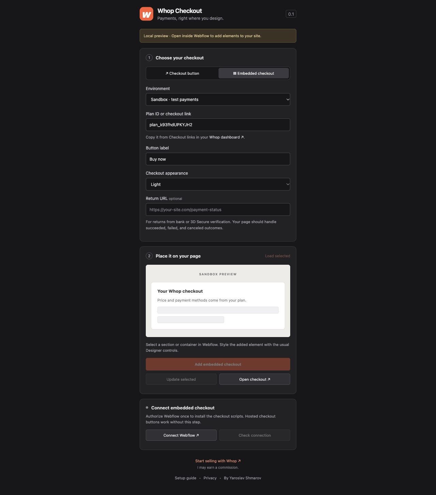

# Whop Checkout for Webflow

Add Whop checkout buttons and embedded payments from the Webflow Designer.

Built by [Yaroslav Shmarov](https://github.com/yshmarov), author of [omniauth-whop](https://github.com/yshmarov/omniauth-whop) and [pay-whop](https://github.com/yshmarov/pay-whop).

**Developer preview.** Tested in the Webflow Designer and with a completed sandbox payment. Public installation is pending permanent hosting and Webflow Marketplace review.



## Features

- Hosted checkout buttons using native, styleable Webflow elements.
- Embedded Whop Checkout Elements, with sandbox/production separation and light/dark appearance.
- Load and update existing checkout elements.
- Webflow OAuth and verified Designer identity tokens.
- Versioned custom-script installation and removal that preserves other scripts.
- Encrypted server-side credentials. No merchant Whop API keys or payment details in the app.

This integration uses Whop checkout independently of Webflow Ecommerce. It does not sync CMS products, create Webflow orders, or gate Webflow pages. See [setup instructions](site/guide.html) and [implementation research](docs/research.md).

[Get started with Whop](https://whop.com/start/?code=CAKARK). *I may earn a commission.*

## Develop

Requires Node 22.13+ and npm.

```sh
npm ci
cp .env.example .env
openssl rand -hex 32
```

Put the generated value in `TOKEN_ENCRYPTION_KEY`. Set `PUBLIC_URL` to the HTTPS address of your development service. Register a Webflow hybrid app with the scopes in [the research notes](docs/research.md), use `PUBLIC_URL/auth/callback` as its redirect, and set the client ID and secret in `.env`. Add its exact Designer Extension origin to `EXTENSION_ORIGINS`.

```sh
npm run build
npm run dev
# Separate terminal:
npm run dev:extension
```

Authorize the app at `PUBLIC_URL/auth/start`. In the demo site's Designer, open Apps → Whop Checkout → Launch development App, using `http://localhost:1337`.

If your browser blocks the HTTP iframe, use `PUBLIC_URL/designer-dev/`. This development-only route proxies the official local extension server over your HTTPS tunnel.

The service defaults to port 4319. A shell-exported PORT overrides `.env`; use `PORT=4319 npm run dev` when needed. The standalone panel at `/extension/` previews the interface; Designer actions require the real Webflow host.

## Validate and bundle

```sh
npm run typecheck
npm run lint
npm test
npm run bundle
npm run review
```

`bundle.zip` contains only the extension. `review.zip` contains its matching source maps and source for Webflow's private review. Rebuild both together after any change. CI's development bundle uses localhost; it is not a Marketplace release artifact.

## Deploy

For Hetzner, use the included [Compose deployment and backup guide](docs/hetzner.md).

Use a durable HTTPS Node host with a persistent disk. SQLite is intended for one service process. Keep `DATA_DIR` and `TOKEN_ENCRYPTION_KEY` across deployments. Back up both securely; replacing the encryption key makes stored connections unreadable.

The Dockerfile accepts `PUBLIC_URL` as a build argument. Pass the same URL at runtime, plus the Webflow credentials, encryption key, exact extension origins, and the persistent data directory. Configure the actual reverse proxy's trusted address range when deploying; local development trusts loopback only. The public service must not expose its database or `.env` file.

Set Webflow's OAuth callback to the permanent host, rebuild the extension, and upload it from an account with two-factor authentication. Use the [Marketplace draft](docs/marketplace.md) to prepare review. The code includes no automatic site publication; publish deliberate site changes in Webflow.

## Checkout lifecycle

The merchant's plan defines the price. Test using a sandbox plan and sandbox cards. Changing the environment does not migrate a plan between Whop environments.

Return pages display payment outcomes; custom fulfillment must verify Whop webhooks on the merchant's server. Apple Pay needs Whop domain verification. To uninstall, remove scripts and disconnect in the app, publish, remove checkout elements, then uninstall in Webflow settings.

## License

MIT
