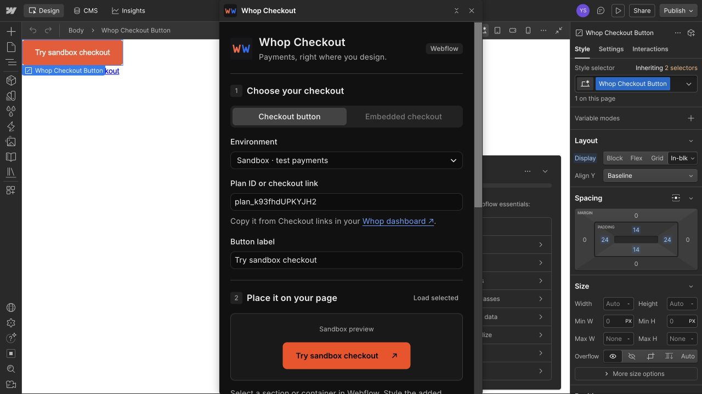

# Frosted UI validation

Verified November 17, 2026, for version 0.1.5 after the owner approved the local preview. The production-origin extension is uploaded for internal workspace testing.

The Designer panel uses pinned Frosted UI components for buttons, fields, selects, tabs, headings, badges, and feedback. App appearance follows the Webflow host where supported, with a system fallback and saved Light/Dark overrides. Checkout appearance remains a separate merchant setting. Static service pages use the same official palettes and self-hosted Inter without a React runtime.

Local review addresses:

- App: http://localhost:4322/extension/
- Homepage: http://localhost:4322/
- Setup guide: http://localhost:4322/guide.html

The local preview service has no Webflow client credentials or saved production connections. Designer insertion, connection, and removal require the real Webflow host. The existing untracked Terms draft remains untouched.

## Verified

- Type checking, lint, build, and 23 tests pass, including theme precedence and unavailable-storage fallback.
- Browser review at the 480 px Designer panel width and a 320 px narrow layout; no horizontal overflow observed.
- Light/dark switching, saved choice after reload, and matching service-page themes.
- Keyboard navigation between checkout tabs, accessible validation feedback, and separation of app theme from checkout appearance.
- No browser console warnings or errors during the local checks; generated theme CSS and self-hosted font serve successfully.
- New checkout button styles use the official orange palette. Existing style reuse and update behavior is preserved.

## Live Webflow checks

Tested the uploaded extension on Whop Commerce Demo with its existing sandbox plan:

- Follow Webflow tracks Light and Dark host changes. An explicit app override wins; Follow Webflow resumes synchronization. Original host System/default-dark settings were restored.
- Native checkout button insertion, loading, label updates, and restoration pass. Existing merchant colors and corner radius remain unchanged.
- Embedded checkout insertion, loading, appearance updates, and restoration pass. Temporary test elements were removed.
- On the final bundle, disconnect removes the scripts and saved connection. OAuth reconnect to the demo site, connection verification, and script installation pass.
- The restored demo was republished. Its original checkout button and one embedded sandbox payment form render successfully. No payment was submitted in this UI smoke test; success/decline payment tests from 0.1.4 remain recorded in [validation](validation.md).
- Live testing caught white text on enabled orange Frosted buttons. The final bundle uses the shared guide's black primary text, verified in the browser.
- No extension-origin warnings or errors were captured in the final Designer check.

## Release artifacts

The 0.1.5 `bundle.zip` and matching `review.zip` use `https://wf-checkout.whoptools.com`. Checksums are recorded in [Marketplace notes](marketplace.md). Previous 0.1.4 artifacts are preserved separately in ignored local backups.

The extension upload is internal testing, not Marketplace publication. Listing screenshots and the narrated walkthrough still need refreshing for Frosted UI before submission. The unapproved Terms draft remains excluded.
